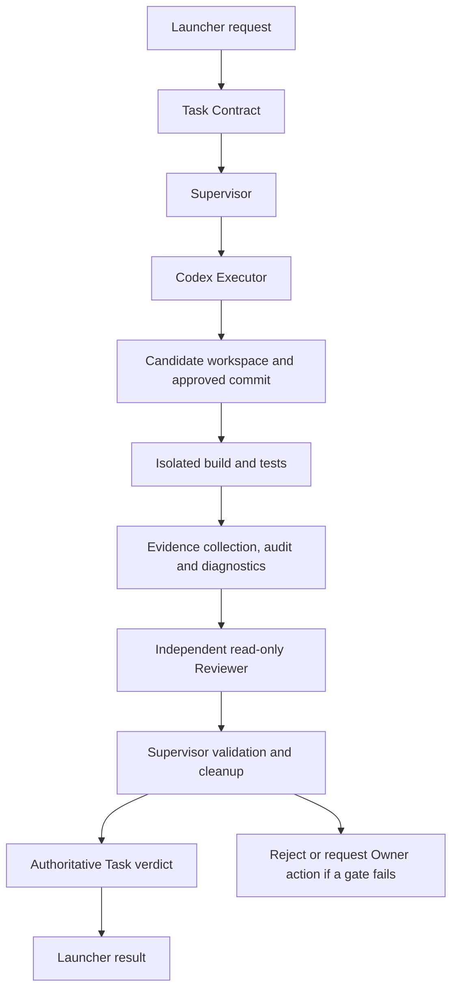

# BAHAO — AI Agent Execution & Verification Prototype

**A constrained AI coding-agent execution and verification prototype with scoped changes, Windows isolation, independent review, evidence-based acceptance, and failure recovery.**

BAHAO asks a practical question: **what evidence should a system require before accepting an AI agent's code change?** An agent saying “done” is not enough. The change must stay within scope, pass the designated checks, reach an independent review, and finish cleanup before the system publishes success.

This is a documentation-only engineering portfolio for an archived prototype. The validated workflow supports a fixed C# source file and its designated verification pipeline. Production source, deployment packages, private logs, and game assets are not distributed here.

| Project status | Evidence-backed scope |
| --- | --- |
| Core frozen | `BAHAO-Core-1.0-V2.2-Stable` |
| Real execution validated | One authorized comment-only change through the complete pipeline |
| Caller result validated | Public Launcher returned authoritative `PASS` |
| Development method | AI-assisted implementation directed and accepted by the project Owner |
| General-purpose autonomy | Not implemented or validated |

## Project overview

Connecting a coding agent to a repository creates several problems beyond generating code: uncontrolled modifications, unverified output, missing independent review, weak failure recovery, and unreliable completion reporting. BAHAO explored these problems through a deliberately narrow execution contract.

The central distinction is:

> **Executor completion is a process outcome. Task acceptance is a separate, evidence-backed decision.**

## What BAHAO does

- Gives a real Codex Executor a bounded task and independently checks its changes against the approved scope.
- Runs candidate build, tests, audit, and diagnostics within a Windows execution boundary, with protected control records outside candidate write authority.
- Binds the task, execution, candidate commit, phase outputs, and review artifacts using identifiers, SHA-256 hashes, and byte lengths.
- Sends verified evidence to a fresh, read-only Codex Reviewer. The Supervisor validates the result; the Reviewer cannot publish Task success itself.
- Tracks resource ownership and supports cleanup or trusted recovery after interruption, refusing ambiguous recovery.
- Exposes a single-command Launcher that returns the authoritative Core verdict rather than interpreting an exit code as success.

These are implemented mechanisms with bounded validation evidence, not guarantees for arbitrary repositories or adversarial environments. See [verification](docs/verification.md) for the exact observations and coverage limits.

## Architecture

The diagram shows one sequential task. Executor and Reviewer have separate sessions and responsibilities. Detailed trust boundaries and artifact relationships are in [architecture](docs/architecture.md).

## Engineering challenges

| Challenge | Engineering response |
| --- | --- |
| Windows MSIX filesystem virtualization and working-directory failures | Established a non-virtualized external host and verified physical paths and the real Executor's working directory. Historical error 267 belongs to this deployment investigation; it is not evidence of a general Windows fix. |
| Candidate execution and ACL boundaries | Separated writable candidate work from trusted control records; used Windows isolation and process containment rather than prompt instructions alone. |
| Durable resource ownership | Recorded ownership before profile and permission changes, then recovered the recorded changes without treating recovery as Task success. |
| Evidence-based escalation | Preserved `ESCALATE` when required build output was only an excerpt. A successful build was insufficient without the required review coverage. |
| Durable caller results | Made Launcher completion a validated projection of Core's committed checkpoint, independent of whether a host result file had been published. |

Read the [engineering case study](docs/engineering-case-study.md) for decisions, failure analysis, and lessons.

## Verification

The archived final Core smoke and the subsequent successful Launcher demonstration used real Codex execution and independent review. In the Launcher demonstration:

| Observation | Recorded result |
| --- | --- |
| Executor | `COMPLETED`; process tree reported empty |
| Authorized change | One comment added in the permitted C# source file |
| Build | Complete, exit code 0 |
| GameCore suite | **248 / 248 passed** |
| Simulator suite | **67 / 67 passed** |
| Audit and diagnosis | All designated phases completed |
| Required evidence | Coverage accepted; required build objects supplied in full |
| Independent Reviewer | `PASS`, bound to packet and input hashes |
| Core checkpoint | `PASSED`, `authority=PRODUCTION`, `productionAuthoritative=true` |
| Launcher caller result | `PASS` from the authoritative checkpoint |
| Resource closure | Recorded cleanup complete for that demonstration |

**The 315 tests belong to two suites in the target MidnightPawn solution. They are not 315 BAHAO-specific unit tests.** The broader frozen regression was **533 passed / 12 failed out of 545**, with the failures recorded as known test issues. That result is not presented as an all-green regression or complete security coverage. The historical delta security review also had conditions and known risks. [Verification](docs/verification.md) preserves those qualifications.

## Known limitations

- Restricted single-file tasks, a fixed acceptance assertion, and a hard-coded C# build/test scope.
- No general-purpose multi-file development or validated all-day unattended operation.
- No Claude Code or Gemini execution adapter, parallel coding team, or automatic provider routing.
- Required evidence larger than **65,536 bytes** may be excerpted and trigger Reviewer escalation.
- A successful comment-only demonstration does not establish feature-development quality, universal isolation, or reliable operation across other machines.
- Known test and coverage gaps remain in the frozen archive.

BAHAO is not a general-purpose autonomous coding platform. See [limitations](docs/limitations.md).

## Ownership and project decision

The Owner defined the problem, scope, permission boundaries, acceptance criteria, and stop conditions; coordinated AI-assisted implementation and review; and made the release and archival decisions. AI tools contributed code and investigation. This portfolio does not claim that the Owner independently hand-wrote the low-level implementation.

The original ambition was a general autonomous development team. After validating the constrained workflow, the Owner stopped expansion because the task interface and evidence pipeline remained tightly coupled to the target project. Further generalization had to compete with existing native Codex capabilities and the cost of continued maintenance.

## Reading guide and distribution

1. [Architecture and trust boundaries](docs/architecture.md)
2. [Engineering case study](docs/engineering-case-study.md)
3. [Verification, provenance, and coverage gaps](docs/verification.md)
4. [Known limitations](docs/limitations.md)

This repository contains original explanatory documentation and sanitized evidence summaries. It does not grant redistribution rights to the private implementation or third-party software. No implementation license is supplied. The original evidence and claim-to-source map are retained privately; the public summaries are not independently reproducible test artifacts.
