# Architecture and trust boundaries

This document describes the frozen implementation at a conceptual level. It is not an installation guide and does not disclose machine-specific accounts, permissions, deployment paths, or runtime configuration. Evidence references such as **E3** refer to the [verification source register](verification.md#evidence-register).

## One task, separate authorities

The Launcher validates and submits a Task Contract through the verified external Windows host. Core remains the authority for execution and acceptance. The Launcher translates Core's committed result for the caller. **[E3, E5]**

| Component | Responsibility | What it cannot establish alone |
| --- | --- | --- |
| Task Contract | Objective, approved workspace baseline, scope, fixed acceptance check, time budget, and output identity | That the requested change was actually made correctly |
| Supervisor | Validate inputs, retain writer ownership, control execution, verify candidate and evidence, publish the verdict | Semantic correctness beyond the available checks and review |
| Codex Executor | Propose the authorized change in an isolated working copy | Task `PASSED`, review acceptance, or permission to widen scope |
| Candidate execution boundary | Run unreviewed candidate build/test/audit/diagnosis with constrained write access | A guarantee against every possible Windows or toolchain vulnerability |
| Independent Codex Reviewer | Reason over the supplied, verified review input and return a bound decision | Direct modification of the repository or authoritative state |
| Launcher | Validate result identity and return `PASS`, `FAIL`, or `WAIT_OWNER` | Success from process exit code alone |

## Execution sequence

1. **Bind the request.** The Supervisor validates the approved contract and baseline, allocates execution identity, and binds the request to the task, scope, starting commit, and deadline. Caller-supplied arbitrary executables or shell commands are not the task interface. **[E4]**
2. **Retain ownership.** The existing workflow writer lock spans execution, candidate creation, and governance. A separate resource ownership protocol coordinates shared runtime permissions and pending recovery. **[E4]**
3. **Execute within scope.** A real Codex Executor works in a separate clone. Windows restrictions protect control records; a post-execution scope check independently evaluates the proposed change. The prompt is not the permission boundary. **[E3, E4]**
4. **Create candidate B from starting commit A.** The Supervisor checks Git identity, stages the permitted change, creates the local candidate, and verifies the expected parent, changed path, and protected region. Unexpected ref changes are rejected by the implemented checks. Coverage qualifications remain in the verification report. **[E4, E6]**
5. **Run designated verification.** Candidate build uses single-node MSBuild. Tests consume the build output, and audit/diagnosis consume bound runtime inputs. The candidate execution boundary uses Windows AppContainer isolation; controlled subprocesses use Job-based lifecycle management. **[E3, E4]**
6. **Collect actual evidence.** Phase descriptors include captured stdout/stderr, outcome, execution identity, candidate identity, and manifest bindings. The review packet and input include the relevant verified evidence. **[E3, E4]**
7. **Review independently.** A fresh read-only Reviewer receives the prepared input. It is a reasoning-only review of supplied evidence, not an independent shell investigation. It returns `PASS`, `FIX_REQUIRED`, or `ESCALATE` with packet/input hashes. **[E3, E4]**
8. **Validate and finalize.** The Supervisor revalidates the candidate, evidence, and review; completes and verifies cleanup; checks Owner control and deadline; then atomically publishes Task success. Workflow completion events are derived from that committed authority. **[E3, E4]**
9. **Return a durable caller result.** The Launcher validates the request-to-checkpoint identity and production authority, then records a caller result. A missing host result does not allow it to invent a verdict. **[E5]**

## Evidence relationships

```mermaid
flowchart LR
    T[Contract hash and Task ID] --> Q[Execution request and execution ID]
    Q --> X[Supervisor-observed execution result]
    X --> C[Candidate A to B and scope result]
    C --> M[Source and runtime manifests]
    M --> E[Phase outputs and Task evidence]
    E --> P[Review packet and input hashes]
    P --> R[Reviewer result with matching hashes]
    R --> V[Validated Task success checkpoint]
    V --> L[Bound Launcher projection]
```

Hashes establish byte identity, not truth or completeness by themselves. Completeness checks, scope validation, executed tests, and review serve different purposes. A valid hash for an excerpt does not turn it into full required evidence. **[E3, E4, E5]**

## Resource ownership and interruption

The frozen design records operation and resource identity before profile creation or permission changes. Recovery checks the recorded owner and associated processes, validates resource identity, and reverses only attributable permission changes. Ambiguous ownership, replaced objects, corrupt records, or conflicting permissions stop recovery and new work. **[E4]**

Normal cleanup by the original Supervisor and compensating recovery by a later trusted process are different outcomes. Recovery restores the environment; it does not restart an interrupted task or award it `PASSED`. The design promises recovery or refusal at the next trusted entry, not instantaneous cleanup after a power loss. **[E4]**

## Authority and failure states

- Executor `COMPLETED` and text such as “done” lead to validation, not acceptance.
- An accepted Reviewer `PASS` is necessary but insufficient without final verification and cleanup.
- Production success carries `authority=PRODUCTION` and `productionAuthoritative=true`.
- SelfTest success uses `TEST_ONLY` / `TEST_PASSED` and cannot be accepted as a production Launcher result.
- The Launcher maps bound Core `PASSED` to `PASS`, `FAILED` to `FAIL`, and blocked or Owner-action states to `WAIT_OWNER`.
- Automatic executable repair remains disabled in the frozen system. A request for fixes is not authorization for an autonomous repair loop.

These rules describe the implementation and recorded demonstrations. They should be read alongside the [known coverage gaps](verification.md#broader-regression-and-security-review).
